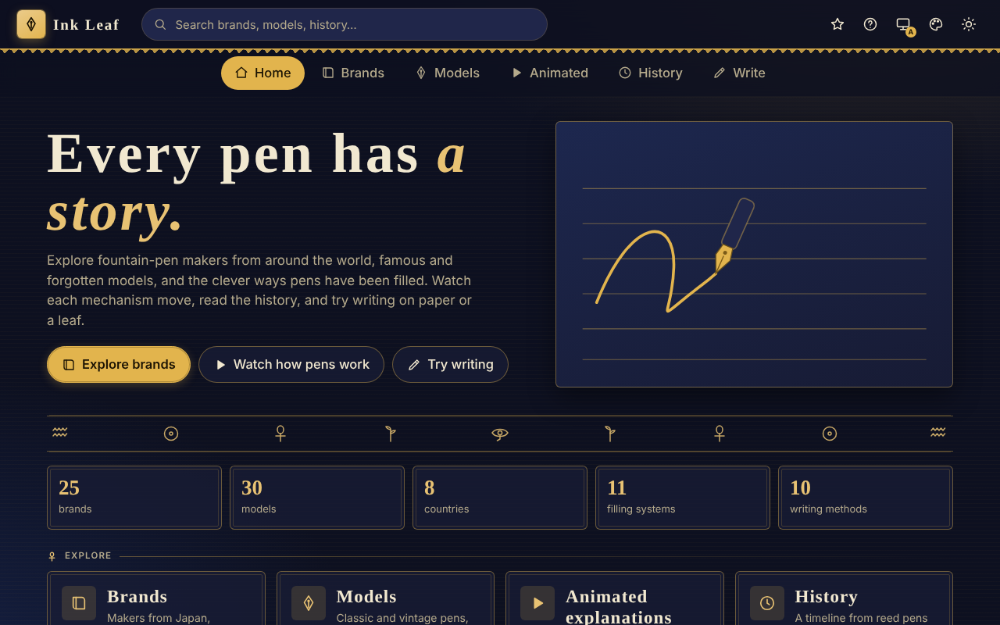
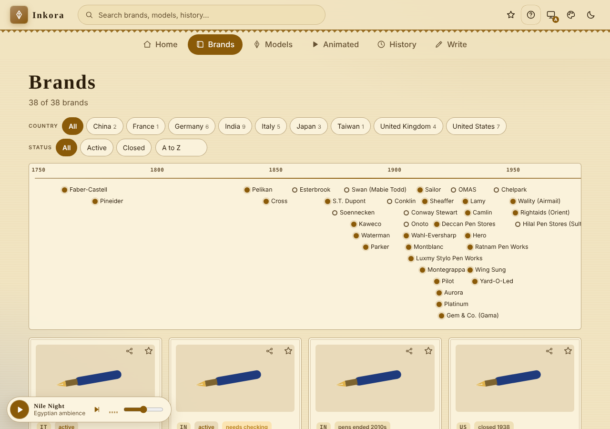
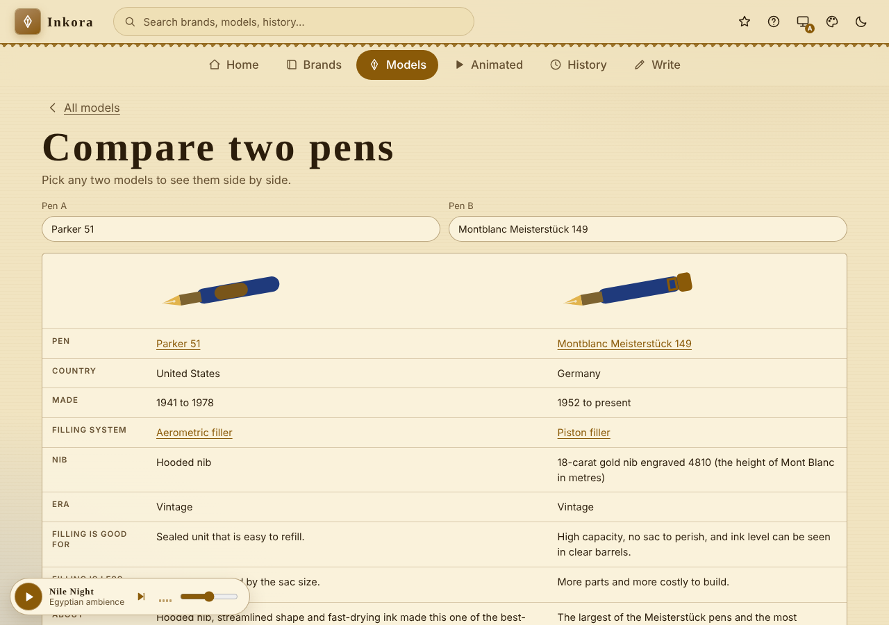
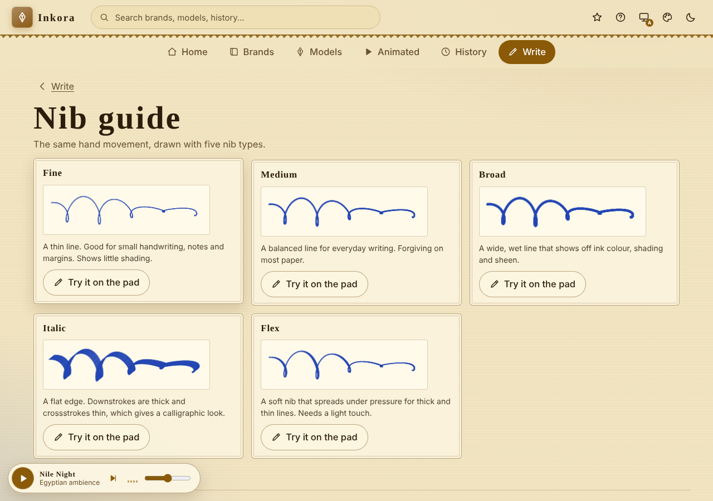
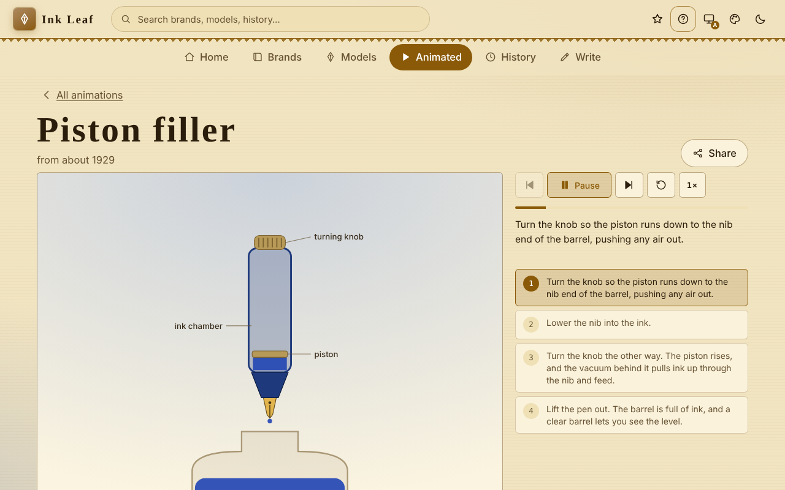

# Inkora

A friendly, installable web app about **fountain pens**: makers from around the world, famous and vintage models, animated explanations of how pens fill and write, a history timeline, old writing methods, and a writing pad where you can try a simulated nib on paper or a leaf.

*Created by **SSK-BLUM**.*



| Brands with photos | Compare two pens | Nib guide |
| --- | --- | --- |
|  |  |  |



## Bundled photos (optional)

Photos load live from Wikipedia and Wikimedia Commons. To save them inside the app so they work offline and on any host, run this once on a computer with internet (Node 18 or newer):

```bash
node tools/fetch-photos.mjs
```

It downloads a free-licence photo for each brand and model into `photos/`, writes the author, licence and credit URL to `photos/credits.json`, and the **i** button on each photo shows them. Then bump `VERSION` in `sw.js` and commit the `photos/` folder.

## Features

- **Brands:** 38 makers across 9 countries, active and closed, including 9 Indian makers (Camlin, Chelpark, Ratnam Pen Works, Luxmy Stylo, Deccan, Hilal/Sultan, Gem/Gama, Rightaids, Wality). Filter by country and status, and sort by name or age.
- **Photos and credits:** brand and model pages show a photo from Wikipedia or Wikimedia Commons when a free-licence one exists. An **Image credit** drop-down lists the author, licence and credit URL. Photos load when you view them, so they need an internet connection.
- **Models:** 34 pens, including old ones from the 1890s and 1910s. Filter by filling system, vintage, era (before 1920, 1920 to 1949, and so on) or brand. Pens with no free photo show a pen illustration instead.
- **Animated explanations:** 12 animations. One shows how a nib writes (nib, feed, capillary flow, air). Eleven show filling systems: eyedropper, crescent, lever, button, plunger, vacuum, piston, snorkel, aerometric, capillary and cartridge. Play, pause, step, restart, change speed, or tap any step.
- **History:** a timeline of 36 events, including India's pen history from reed pens to the modern pen, with filters.
- **Old writing methods:** 10 methods, from clay and reeds to wax, brushes, birch bark, quills and palm leaves.
- **Write:** paper, fresh leaf or palm leaf. Fine, medium, broad, italic, flex and stylus nibs. Ink looks wet, then dries. On a palm leaf you scratch with a stylus, then **Rub soot** to darken the grooves. Undo, Clear, Save as PNG.
- **Background music:** a small player (bottom corner, key **M**) with play/pause and volume. The Egyptian-style ambience (drone, plucked strings in a Hijaz scale, soft drum, finger-cymbal chimes, desert wind) is generated in the browser with Web Audio. No audio files, so it is original, license-free and works offline. It never starts by itself.
- **Brand timeline strip:** every brand on a scrolling line by founding year, with closed makers shown as hollow dots.
- **Compare two pens, Which pen suits you? quiz, Nib guide, Pen words glossary and a story page on Pens in India.**
- **Copy link** on every brand and model card, plus a drawn pen illustration (matching its filling system) when no free photo exists.
- **Reading options:** large text and high contrast, under the colour button.
- **Two music tracks:** Nile Night and Temple Dawn (the skip button on the player).
- **Search, Saved:** one search box across everything. Star brands and models to keep them on this device.
- **Modern UI:** ancient-Egypt look (lapis night, papyrus light, gold leaf, hieroglyph-style friezes), light, dark or auto theme, and eight pigment colours.
- **Optimise layout button:** Auto, Mobile, Tab or Web.
- **How to use button:** a guide to every control, with **Show me** highlights and a one-minute tour.
- **About window:** credits, record counts and sources.
- **PWA:** installable, works offline after the first visit.

## Run it

There is no build step. Serve the folder over HTTP. The service worker and install need `localhost` or HTTPS.

```bash
python3 -m http.server 8080
# open http://localhost:8080
```

Deploying: `.github/workflows/pages.yml` publishes the folder to GitHub Pages on every push to `main`.

## Accuracy and credits

- Every record links to a public reference, mostly Wikipedia articles. Records that are less certain carry a **needs checking** tag. Please confirm details with the maker or a pen-history reference.
- Photos are free-licence images from Wikimedia, loaded live and never stored in this repository. Logos are never shown.
- No copied artwork. Pens and mechanisms are drawn in code. Brand names are text only and belong to their owners. Inkora is not affiliated with any maker.
- No accounts, no tracking, no API keys. Settings and saved items stay in your browser (`il-` keys in localStorage).
- Music is synthesised live and not recorded from any existing piece.
- Fonts: Cinzel and Alegreya Sans (Google Fonts).

## More

- [PROJECT.md](PROJECT.md): how the app works and how it is structured.
- [CLAUDE.md](CLAUDE.md): rules for coding agents.

## License

MIT © SSK-BLUM. See [LICENSE](LICENSE).
